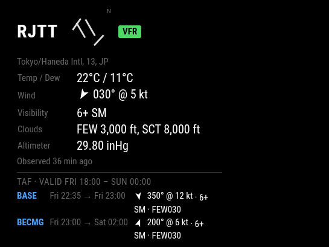

[README.md](https://github.com/user-attachments/files/34222372/README.md)
# MMM-MetarTaf



A [MagicMirror²](https://magicmirror.builders/) module that shows decoded METAR observations for any airport with an ICAO code, with optional TAF forecasts, wind direction arrows and runway diagrams.

Data comes from the NOAA Aviation Weather Center Data API, which carries METARs and TAFs for stations worldwide. No API key required.

> **AI disclosure:** this module was written with the help of an AI assistant (Claude, by Anthropic). See [AI disclosure](#ai-disclosure) below.

**Status:** actively maintained.

## Install

```bash
cd ~/MagicMirror/modules
git clone https://github.com/PeanutToes6/MMM-MetarTaf
```

No `npm install` needed (uses Node's built-in `fetch`, so Node 18+).

## Config

```js
{
  module: "MMM-MetarTaf",
  position: "top_left",
  header: "Aviation Weather",
  config: {
    stations: ["KATL", "OMDB", "RJTT", "EGLL", "KDFW"],
    tempUnit: "C",
    windUnit: "kt",
    showWindArrow: true,
    showRunways: true,
    runwaySize: 64,
    showTAF: true,
    tafMaxPeriods: 4,
    tafTimeFormat: "local"
  }
}
```

| Option | Default | Description |
|---|---|---|
| `stations` | `["KATL"]` | ICAO identifiers |
| `updateInterval` | `600000` | Refresh rate in ms (minimum 60000) |
| `hoursBack` | `3` | How far back to look for the latest report |
| `tempUnit` | `"C"` | `"C"` or `"F"` |
| `windUnit` | `"kt"` | `"kt"` or `"kmh"` |
| `visUnit` | `"sm"` | `"sm"` or `"km"` |
| `pressureUnit` | `"inHg"` | `"inHg"` or `"hPa"` |
| `showStationName` | `true` | Show airport name |
| `showFlightCategory` | `true` | Show VFR/MVFR/IFR/LIFR badge |
| `showWindArrow` | `true` | Arrow pointing the direction the wind is blowing toward |
| `showRaw` | `false` | Show the raw METAR string |
| `staleMinutes` | `90` | Dim a report older than this |
| `showRunways` | `false` | Draw the airport's runways (north up) beside the ICAO |
| `runwaySize` | `64` | Runway diagram size in px |
| `showRunwayLabels` | `false` | Print runway numbers at each end |
| `showTAF` | `false` | Show the TAF forecast under each METAR |
| `tafMaxPeriods` | `4` | Number of upcoming forecast periods to list |
| `tafTimeFormat` | `"local"` | `"local"` or `"utc"` |
| `showTafRaw` | `false` | Show the raw TAF string |

## Notes

- Wind arrows point where the wind is going, so a westerly (270°) wind shows an arrow pointing east. Variable winds (VRB) show a ↻ symbol instead.
- Runway diagrams are drawn with true north up. Where threshold coordinates exist, runways are placed exactly as laid out on the airport, so parallel and crossing runways appear correctly. If an airport has no coordinates, runways are centred on their heading and parallels are fanned out side by side. Closed runways and helipads are skipped.
- Runway data comes from [OurAirports](https://ourairports.com/data/) (public domain, worldwide coverage). The first start downloads its runway list (a few MB) and saves the results for your stations to `runway-cache.json` in the module folder, refreshed every 90 days. Delete that file to force a refresh. If the download fails, the module just shows no diagram.
- TAFs are only issued for some airports. Stations without one show "No TAF issued for this station".
- TAF periods are labelled BASE, FM, BECMG, TEMPO, or with a probability (e.g. `TEMPO 30`). TEMPO and PROB groups are shown in amber.

## Station IDs

Use the four-letter ICAO code (e.g. `KATL`, not the IATA code `ATL`). Not every airport issues a METAR, and fewer issue a TAF.

Some large airports to try:

| ICAO | Airport |
|---|---|
| `KATL` | Atlanta Hartsfield-Jackson, USA |
| `OMDB` | Dubai International, UAE |
| `RJTT` | Tokyo Haneda, Japan |
| `EGLL` | London Heathrow, UK |
| `KDFW` | Dallas/Fort Worth, USA |

## Data sources and credits

- Weather: [NOAA Aviation Weather Center](https://aviationweather.gov/) Data API
- Runways: [OurAirports](https://ourairports.com/data/) (public domain)

## AI disclosure

The code in this module was written by Claude, an AI assistant made by Anthropic, working from my instructions and feedback. I tested it on a real MagicMirror, and I published and maintain it. I am not a programmer, but I wanted to fill a niche in my MagicMirror, and AI made that possible for me. If you prefer not to use or support AI-assisted software, you are welcome to skip this module, and I understand.

## License

MIT
